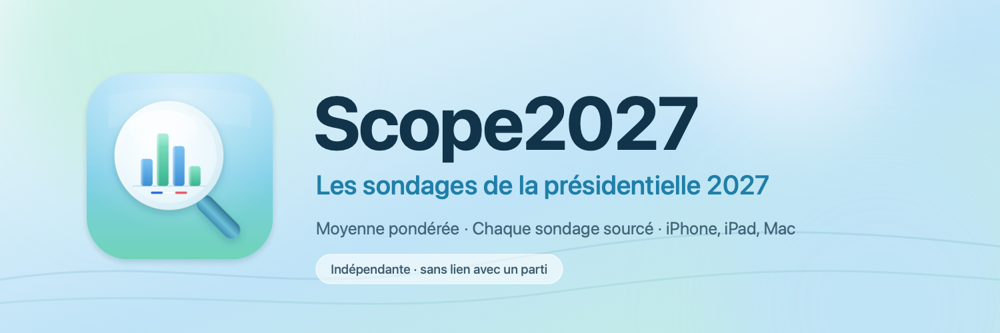

# Sondoscope

App SwiftUI (iPhone, iPad, Mac natif, widgets) qui suit les intentions de vote à la présidentielle de 2027.

## Lancer
1. Ouvrir `Sondoscope.xcodeproj`.
2. Choisir le schéma `Sondoscope`, puis une destination.
3. Lancer. L'app embarque un instantané réel dans `Shared/Resources/polls.json`.
4. Tests : Cmd+U.

## Structure
- `Shared/` : domaine, moteur de calcul, données, design system (compilés dans l'app, le widget et les tests).
- `Sondoscope/` : app et écrans. `SondoscopeWidget/` : widget. `SondoscopeTests/` : tests.
- `pipeline/` : préparation de `polls.json`. `docs/update-polls.yml` : exécution quotidienne, à placer dans `.github/workflows/`.
- `branding/` : SVG du logo et pistes. `python3 generate_icons.py` régénère les SVG.

## Mettre à jour les données
1. Placer les fichiers JSON d'origine dans `pipeline/raw/` sous les noms `sondages.json` et `candidatures.json`.
2. Lancer `python3 pipeline/build_polls.py`, puis copier `public/polls.json` vers `Shared/Resources/polls.json`.

## Mise à jour automatique
1. Déplacer `docs/update-polls.yml` vers `.github/workflows/`, pousser le dépôt sur GitHub, activer Pages avec la source « GitHub Actions ».
2. Renseigner `AppConfig.remoteDataURL`.

Le workflow tourne toutes les trois heures, de 6 h à minuit.

## Ajouter un sondage sans attendre 2027etmoi
1. Dans `pipeline/manual/sondages.json`, ajouter l'enquête à `sondages`, au format du fichier 2027etmoi (`institut`, `commanditaire`, `terrain_debut`, `terrain_fin`, `echantillon`, `source.url` vers la notice de la Commission des sondages, `hypotheses` avec les identifiants de `candidatures.json`). Renseigner `mise_a_jour`.
2. Recopier les chiffres de la notice officielle, jamais d'un article de presse.
3. Pousser sur `main` : la publication part aussitôt. Un identifiant de candidat inconnu, une notice absente ou un total loin de 100 bloquent la publication.

Quand 2027etmoi publie la même enquête (même institut, mêmes dates), sa version remplace la saisie manuelle, y compris dans l'archive. L'entrée peut alors être retirée du fichier.

Le fichier de 2027etmoi ne couvre qu'environ sept semaines : c'est `pipeline/archive/` qui conserve l'historique. Vérifier avant mise en ligne que l'accès automatisé à data.gouv.fr est autorisé pour ce téléchargement.

## Moyenne
Fenêtre de 60 jours, demi-vie de 7 jours, poids d'échantillon √(n/1000) plafonné à 1,5, poids d'institut 0,5^rang, hypothèse la plus proche par Jaccard. Réglages : `AverageSettings`.

## Avant publication
Faire vérifier le silence électoral et les mentions légales, puis la disponibilité du nom.

URL de confidentialité : https://jcanger.github.io/Sondoscope/confidentialite.html
